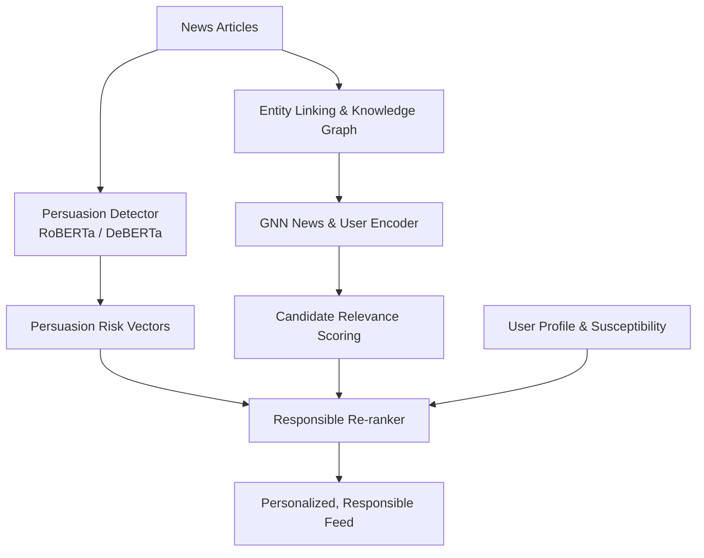

# Responsible News Recommendation

> **Persuasion-Aware, Knowledge-Graph-Augmented Recommendation for Trustworthy News Delivery**  
> *Aligned with United Nations Sustainable Development Goal 16: Peace, Justice and Strong Institutions*

---

## 📌 Overview

Personalized recommender systems optimizing solely for engagement (e.g., Click-Through Rate) often inadvertently amplify sensational, emotionally charged, or manipulative content. This project introduces a **Persuasion-Aware News Recommendation System** that balances user relevance with content trustworthiness.

By integrating:
1. **Transformer-based Persuasion Detection** (identifying rhetorical techniques like loaded language, fear appeals, and appeals to authority)
2. **Knowledge-Graph Augmentation** (entity linking and semantic relations)
3. **Graph Neural Network (GNN) User-Item Modeling**
4. **Responsible News Scoring (RNS)** with customizable trade-off parameters ($\alpha$ vs $\beta$) and provider diversity capping

the system delivers personalized news feeds that actively mitigate exposure to manipulation and polarization.

---

## 🏛️ System Architecture



### Key Components
- **Persuasion Detection Engine**: Sentence-level rhetorical technique classification across multiple categories (loaded language, fear appeals, authority appeals, etc.).
- **Knowledge Graph & GNN**: Entity-level representations augmenting content embeddings for robust semantic understanding.
- **Dynamic Responsible Re-ranking**: Combines relevance and persuasion penalties:
  $$\text{Final Score} = \alpha \cdot \text{Relevance} - \beta \cdot \text{PersuasionRisk}$$
  with publisher diversity caps to prevent echo chambers.
- **Interactive UI Dashboard**: React + TypeScript frontend featuring dynamic sliders for $\alpha$ and $\beta$, live article persuasion scoring, radar charts, and SDG 16 metric tracking.

---

## 📂 Project Structure

```
├── checkpoints/             # Trained model weights and graph checkpoints
├── data/
│   ├── raw/                 # Raw datasets (MIND, SemEval-2023, etc.)
│   └── processed/           # Processed datasets and feature caches
├── frontend/                # React + Vite + TypeScript frontend
│   ├── src/
│   │   ├── components/      # UI components (FeedPage, LiveScorer, PersuasionRadar, etc.)
│   │   ├── api.ts           # API client integration
│   │   ├── App.tsx          # Main application layout
│   │   └── index.css        # Styling and theme tokens
│   ├── package.json
│   └── vite.config.ts
├── logs/                    # Training and execution logs
├── notebooks/               # Jupyter exploration and analysis notebooks
├── src/                     # Backend Python core package
│   ├── api/                 # FastAPI REST API endpoints
│   ├── data/                # Data downloading, DB schema, and preprocessing
│   ├── evaluation/          # Benchmarking, metrics, and Pareto frontier analysis
│   ├── graph/               # Knowledge graph construction and utilities
│   ├── models/              # GNN encoder and persuasion detector architectures
│   └── ranking/             # Responsible news scoring and re-ranking algorithms
├── .env.example             # Template environment variables
├── requirements.txt         # Python dependencies
└── Responsible_News_Recommendation_Report.docx  # Full project research report
```

---

## 🚀 Quick Start

### 1. Prerequisites
- **Python 3.10+**
- **Node.js 18+** & **npm**

### 2. Backend Setup

```bash
# Clone the repository
git clone https://github.com/karthiksteve/recommentation_news.git
cd recommentation_news

# Set up virtual environment
python -m venv .venv
# On Windows:
.venv\Scripts\activate
# On Linux/macOS:
# source .venv/bin/activate

# Install dependencies
pip install -r requirements.txt

# Configure environment variables
cp .env.example .env

# Initialize synthetic dataset / database (for demonstration)
python -m src.data.generate_synthetic_data
python -m src.data.init_db

# Run FastAPI backend
uvicorn src.api.main:app --host 0.0.0.0 --port 8000 --reload
```

### 3. Frontend Setup

```bash
cd frontend

# Install npm packages
npm install

# Start development server
npm run dev
```

Open [http://localhost:5173](http://localhost:5173) in your browser to access the application.

---

## 📊 Evaluation & Metrics

The system is evaluated on both standard recommendation metrics and responsible AI indicators:
- **Accuracy**: AUC, nDCG@5, nDCG@10
- **Persuasion Exposure Reduction (PER)**: Percentage drop in high-persuasion articles presented to susceptible readers
- **Provider Diversity**: Gini index and single-provider cap compliance
- **Fairness & Explainability**: Sentence-level highlight transparency and category radar breakdowns

---

## 🤝 Alignment with UN SDG 16

This project directly addresses **Target 16.10** (*Ensure public access to information and protect fundamental freedoms*) and **Target 16.6** (*Develop effective, accountable and transparent institutions*) by curtailing exposure to manipulative framing, mitigating epistemic polarization, and fostering healthy public discourse.

---

## 📄 License

This project is licensed under the MIT License.
