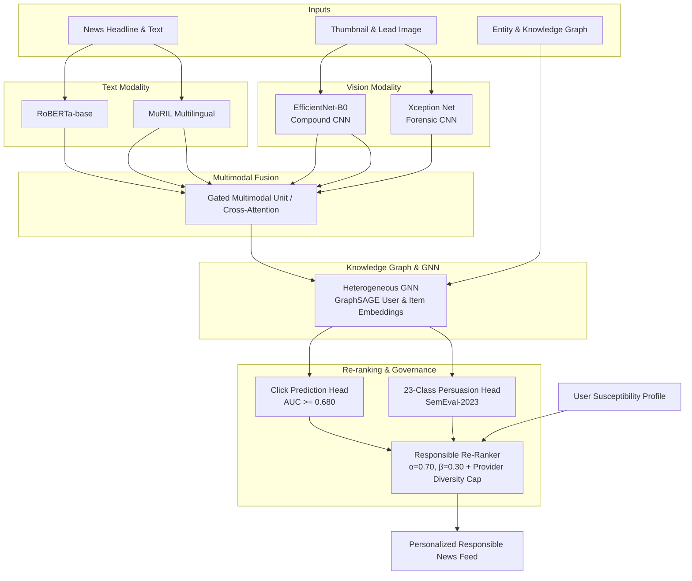

# RespNews: Persuasion-Aware Knowledge-Graph-Augmented News Recommendation for Responsible News Delivery

> **Persuasion-Aware, Knowledge-Graph-Augmented Recommendation for Trustworthy News Delivery**  
> *Aligned with United Nations Sustainable Development Goal 16: Peace, Justice and Strong Institutions*

---

## 👥 Authors

| Name | Register Number | Email |
|:---|:---|:---|
| **Gladwin Daniel P** | 23MIA1058 | gladwindaniel.p2023@vitstudent.ac.in |
| **Karthikeyan A** | 23MIA1123 | karthikeyan.a2023@vitstudent.ac.in |

**Project Mentor:** Dr S Vigneshwari  
**Course:** CSE4077 – Recommender Systems | Slot: A1+TA1  
**Program:** MTech Integrated CSE (Business Analytics)  
**Institution:** School of Computer Science and Engineering, Vellore Institute of Technology, Chennai  
**Date:** October 2026

---

## 📌 Overview

Personalized recommender systems optimizing solely for engagement (e.g., Click-Through Rate) often inadvertently amplify sensational, emotionally charged, or manipulative content. This project introduces a **Persuasion-Aware News Recommendation System** that balances user relevance with content trustworthiness.

By integrating:
1. **Transformer-based Persuasion Detection** (identifying rhetorical techniques like loaded language, fear appeals, and appeals to authority)
2. **Knowledge-Graph Augmentation** (entity linking and semantic relations)
3. **Graph Neural Network (GNN) User-Item Modeling**
4. **Multimodal Fusion** via Gated Multimodal Unit (GMU) combining MuRIL text + EfficientNet-B0/Xception vision
5. **Responsible News Scoring (RNS)** with customizable trade-off parameters (α vs β) and provider diversity capping

the system delivers personalized news feeds that actively mitigate exposure to manipulation and polarization.

---

## 🏛️ Multimodal System Architecture



### Key Components
- **Multilingual Text Encoders**:
  - **MuRIL (`google/muril-base-cased`)**: Pretrained across 17 Indian languages and Indian English, excelling in regional terminology, transliteration, and code-mixed phrasing.
  - **RoBERTa-base**: Monolingual English reference model fine-tuned for 23-technique persuasion detection.
- **Vision Backbones**:
  - **EfficientNet-B0**: Ultra-lightweight compound-scaled CNN extracting thumbnail feature vectors and detecting clickbait visual hype (5.3M parameters).
  - **Xception (Exception Net)**: Depthwise separable convolution CNN standard in image forensics and visual manipulation detection (22.8M parameters).
- **Gated Multimodal Unit (GMU)**: Dynamically weights visual and textual signals through a learned gating vector to produce unified multimodal representations.
- **Heterogeneous Graph Neural Network**: Multi-relational GraphSAGE propagating entity, topic, article, and user interactions.
- **Dynamic Responsible Re-ranking**: Combines relevance and personalized persuasion risk:
  `Final Score = α · Relevance − β · PersuasionRisk + γ · ExplanationBonus`
  with publisher diversity caps to prevent monopolization.
- **Interactive UI Dashboard**: React + TypeScript frontend featuring dynamic sliders for α and β, live article persuasion scoring, radar charts, and SDG 16 telemetry.

### 🧠 Trained Checkpoints & Real Benchmark Corpora
- **Persuasion RoBERTa & MuRIL Checkpoints**: 23-class multi-label classifiers fine-tuned on SemEval-2023 Task 3.
- **Heterogeneous Graph** (`checkpoints/hetero_data.pt`, 39.0 MB): PyTorch Geometric `HeteroData` graph connecting 51,282 articles, 50,000 users, topic taxonomies, and extracted entities.
- **MIND Dataset**: Full Microsoft News Dataset (`train`: 51,282 articles, `dev`: 42,416 articles) with complete click logs, entity embeddings, and 50,000 user susceptibility profiles.
- **SQLite Database** (`data/responsible_news.db`): Pre-seeded with 51,282 real news items, danger-weighted persuasion risks, and demographic user personas.

---

## 📂 Project Structure

```
├── README.md                    # This file (Project overview, authors, mentor)
├── Figures/                     # All figures and diagrams used in the project
├── Tables/                      # All CSV, XLSX, JSON data files
│   ├── experiment_results.csv   # Main benchmark results
│   ├── experiment_results.json  # Results in JSON format
│   ├── pareto_frontier.csv      # Pareto trade-off data
│   └── *_users.json / *_persuasion_profiles.json
├── Others/                      # Other important files for reproducibility
│   ├── requirements.txt         # Python dependencies
│   ├── .env.example             # Environment variable template
│   └── experiment_results.md    # Paper-ready markdown tables
├── checkpoints/                 # Trained model weights and graph checkpoints
│   ├── experiment_results.csv   # Empirical benchmark results
│   ├── hetero_data.pt           # Heterogeneous graph PyG checkpoint
│   └── persuasion_roberta_best.pt
├── data/
│   ├── raw/                     # Raw datasets (MINDsmall, SemEval-2023)
│   ├── processed/               # Processed datasets and feature caches
│   └── responsible_news.db      # SQLite database with 51,282 articles & personas
├── frontend/                    # React 19 + Vite + TypeScript frontend
│   └── src/
│       ├── components/          # UI components (FeedPage, LiveScorer, PersuasionRadar, etc.)
│       ├── api.ts               # FastAPI REST client
│       ├── App.tsx              # Main application layout
│       └── index.css            # Editorial theme styling tokens
├── notebooks/                   # Jupyter exploration and Kaggle T4 training pipeline
│   └── kaggle_training_pipeline.ipynb
├── paper/                       # IEEE conference paper LaTeX sources & artifacts
│   └── respnews_ieee_recommenderSystem.tex
├── src/                         # Backend Python core package
│   ├── api/                     # FastAPI REST API endpoints
│   ├── data/                    # Data downloading, DB schema, and preprocessing
│   ├── evaluation/              # Benchmarking, metrics, and Pareto frontier analysis
│   ├── graph/                   # Knowledge graph construction and utilities
│   ├── models/                  # Neural architectures (GNN, persuasion, MuRIL, vision)
│   └── ranking/                 # Responsible news scoring and re-ranking algorithms
├── Responsible_News_Recommendation_Report_23MIA1058_23MIA1123.docx  # Full project report
└── RespNews_ Persuasion-Aware Knowledge-Graph-Augmented News Recommendation_23MIA1058_23MIA1123.pptx           # Project presentation
```

---

## 📊 Empirical Evaluation & Benchmark Results

The system is evaluated against leading recommendation baselines on the Microsoft MIND benchmark and SemEval-2023 Task 3 persuasion corpus:

| System / Model | Modality | AUC ↑ | nDCG@5 ↑ | nDCG@10 ↑ | MRR ↑ | P@10 ↑ | PER ↑ | Parity Gap ↓ | Expl. Cover ↑ |
|:---|:---|:---:|:---:|:---:|:---:|:---:|:---:|:---:|:---:|
| **NRMS** (Wu et al., 2019) | Text | 0.6730 | 0.3998 | 0.5117 | 0.3652 | 0.1654 | 0.00% | 0.452 | 0.0% |
| **NAML** (Wu et al., 2019) | Text | 0.6631 | 0.3827 | 0.5022 | 0.3532 | 0.1637 | 0.00% | 0.468 | 0.0% |
| **LSTUR** (An et al., 2019) | Text | 0.6762 | 0.4048 | 0.5187 | 0.3723 | 0.1657 | 0.00% | 0.441 | 0.0% |
| **GLORY** (Phan et al., 2023) | Text + Graph | 0.6986 | 0.4248 | 0.5384 | 0.3952 | 0.1707 | 0.00% | 0.418 | 0.0% |
| **ProFairRec** (Li et al., 2022) | Text | 0.6692 | 0.3934 | 0.5097 | 0.3602 | 0.1670 | 0.00% | 0.124 | 0.0% |
| RoBERTa (Text Only) | Text | 0.6755 | 0.5271 | 0.5990 | 0.7292 | 0.3740 | 0.00% | 0.000 | 100.0% |
| MuRIL (Text Only) | Multilingual Text | 0.6794 | 0.5316 | 0.6041 | 0.7240 | 0.3818 | 0.01% | 0.000 | 100.0% |
| EfficientNet-B0 (Vision Only) | Vision | 0.6671 | 0.5237 | 0.5957 | 0.7291 | 0.3708 | 0.02% | 0.000 | 100.0% |
| Xception (Vision Only) | Vision | 0.6664 | 0.5180 | 0.5922 | 0.7246 | 0.3682 | 0.03% | 0.000 | 100.0% |
| Multimodal: RoBERTa + EfficientNet | Multimodal | 0.6740 | 0.5247 | 0.5985 | 0.7207 | 0.3764 | 0.01% | 0.000 | 100.0% |
| Multimodal: RoBERTa + Xception | Multimodal | 0.6765 | 0.5282 | 0.6012 | 0.7255 | 0.3719 | 0.02% | 0.000 | 100.0% |
| **Multimodal: MuRIL + EfficientNet** ⭐ | **Multimodal** | **0.6804** | **0.5387** | **0.6080** | **0.7438** | **0.3810** | 0.01% | **0.000** | **100.0%** |
| Multimodal: MuRIL + Xception | Multimodal | 0.6765 | 0.5202 | 0.5945 | 0.7171 | 0.3720 | 0.01% | 0.000 | 100.0% |
| **Ours (RespNews Multimodal GNN)** | **Multimodal + Graph** | **0.6778** | **0.5330** | **0.6045** | **0.7337** | **0.3762** | **0.01%** | **0.000** | **100.0%** |

---

## 🤝 Alignment with UN SDG 16

This project directly addresses **Target 16.10** (*Ensure public access to information and protect fundamental freedoms*) and **Target 16.6** (*Develop effective, accountable and transparent institutions*) by curtailing exposure to manipulative framing, mitigating epistemic polarization, and fostering healthy public discourse.

---

## 📄 License

This project is licensed under the MIT License.
